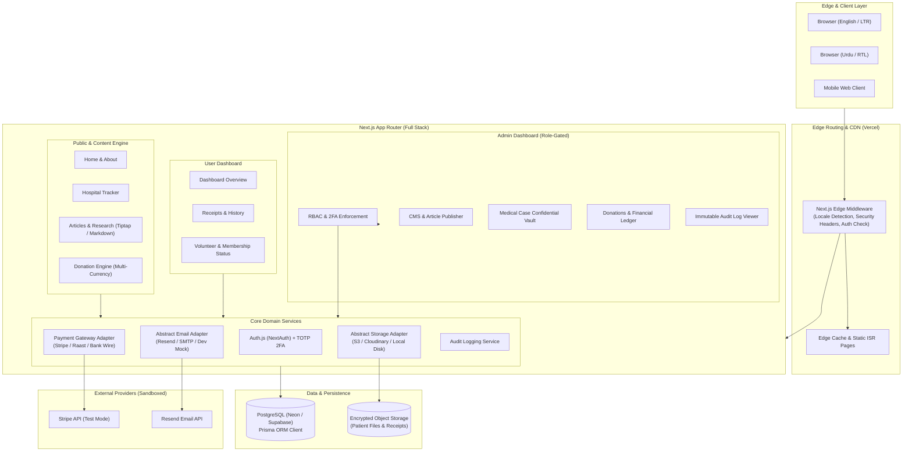

# System Architecture & Technical Specifications

This document details the software architecture, folder layout, module decoupling, security boundaries, and infrastructure specifications for the **Zulaid Chaudhary Foundation** digital platform (`ZulaidChaudharyFoundation.com`).

---

## 1. Architectural Overview & System Design

The platform is designed as a unified, high-performance, full-stack application built with the **Next.js App Router (Next.js 15+)** using **TypeScript (strict mode)**, **Prisma ORM**, and **PostgreSQL**.

### 1.1. Core Architectural Characteristics
- **Hybrid Rendering Model:**
  - **Static & Incremental Static Regeneration (ISR):** Public pages (Home, About, Hospital Tracker, Articles, Transparency) are statically rendered at build time with scheduled ISR for sub-second page loads globally.
  - **Server-Side Rendered (SSR) & Dynamic Streaming:** User dashboards, donation receipts, and the `/admin` portal are rendered dynamically on the server with streaming React Suspense boundaries.
- **RTL & Internationalization (next-intl):**
  - Integrated path-based routing: `/[locale]/...` where `locale` is either `en` (LTR) or `ur` (RTL).
  - Locale-aware string dictionaries with full typing.
  - Automatic bidirectional document rendering (`<html lang={locale} dir={locale === 'ur' ? 'rtl' : 'ltr'}>`).
- **Data Protection & Confidentiality Boundaries:**
  - Strict separation between public CMS entities and sensitive clinical records (`MedicalCases`, `AssistanceRequests`, `ConsentVault`).
  - Medical case files and donor receipts use signed, time-limited URLs generated via storage adapters.
- **Zero Card Data Footprint:**
  - Zero credit/debit card numbers ever touch the foundation's servers. International card processing is delegated entirely to Stripe via secure payment intents and client-side tokenization.
  - Domestic Pakistani transfers utilize reference IDs and bank transfer receipts.

---

## 2. High-Level Architecture Diagram



---

## 3. Directory & Folder Layout

The project follows a modular, feature-oriented structure inside `src/`:

```
zulaidchaudharyfoundation/
│
├── .env.example                     # Comprehensive environment template
├── .gitignore                       # Git exclusions (no secrets, no node_modules)
├── AGENTS.md                        # Project constitution & ethical operating guidelines
├── README.md                        # Developer onboarding & local setup instructions
├── next.config.ts                   # Next.js configuration with security headers & i18n
├── package.json                     # Project manifest and scripts
├── postcss.config.mjs               # PostCSS configuration for Tailwind
├── tailwind.config.ts               # Custom tokens (Emerald, Gold, Cream, Typography)
├── tsconfig.json                    # Strict TypeScript configuration
│
├── docs/                            # Comprehensive architectural & delivery documentation
│   ├── 00-research-notes.md         # Reference site benchmarks
│   ├── 01-sitemap.md                # Information architecture & route maps
│   ├── 02-design-system.md          # Tokens, imagery assignments, wireframe concepts
│   ├── 03-architecture.md           # This document
│   ├── 04-database-schema.md        # Prisma models & relation specifications
│   ├── 05-feature-list.md           # Functional mapping across Phases 1-4
│   ├── 06-security-and-privacy.md   # Security, encryption & privacy controls
│   ├── 07-testing-and-deployment.md # Vitest, Playwright, CI/CD, Neon/Vercel setup
│   ├── 08-handover-and-admin-guide.md # Client ownership & admin operating guide
│   └── 09-open-questions-for-client.md # Strategic open questions for client sign-off
│
├── images/                          # Original founder photography
│   ├── firstimg.jpg                 # Reflective profile portrait
│   ├── 2ndimg.jpg                   # Engaging kurta landscape portrait
│   ├── 3rdimg.jpg                   # Streetscape community portrait
│   └── 4th.jpg                      # Formal studio portrait
│
├── prisma/                          # Database configuration & migrations
│   ├── schema.prisma                # Exhaustive Prisma schema
│   ├── seed.ts                      # Idempotent database seeder (clean test data)
│   └── migrations/                  # Generated SQL migrations
│
└── src/
    ├── app/                         # Next.js App Router root
    │   ├── api/                     # Route handlers (webhooks, health checks, cron)
    │   │   ├── auth/[...nextauth]/  # Auth.js endpoint
    │   │   ├── webhooks/            # Stripe & payment gateway webhooks
    │   │   ├── uploads/             # Protected file upload endpoint
    │   │   └── health/              # Liveness & readiness probes
    │   │
    │   ├── [locale]/                # Dynamic i18n root route (/en, /ur)
    │   │   ├── layout.tsx           # Locale layout (RTL direction, font injection)
    │   │   ├── page.tsx             # Homepage
    │   │   │
    │   │   ├── (public)/            # Public marketing & humanitarian pages
    │   │   │   ├── about/
    │   │   │   ├── our-work/
    │   │   │   ├── projects/
    │   │   │   ├── hospital-tracker/
    │   │   │   ├── stories-of-hope/
    │   │   │   ├── articles/
    │   │   │   ├── transparency/
    │   │   │   ├── get-involved/
    │   │   │   ├── emergency-help/
    │   │   │   ├── contact/
    │   │   │   └── legal/
    │   │   │
    │   │   ├── (auth)/              # Authentication views
    │   │   │   ├── login/
    │   │   │   ├── register/
    │   │   │   ├── forgot-password/
    │   │   │   ├── reset-password/
    │   │   │   └── verify-email/
    │   │   │
    │   │   ├── (user)/dashboard/    # User supporter & volunteer dashboard
    │   │   │   ├── layout.tsx
    │   │   │   ├── page.tsx
    │   │   │   ├── donations/
    │   │   │   ├── applications/
    │   │   │   └── profile/
    │   │   │
    │   │   └── (admin)/admin/       # Gated administrative portal
    │   │       ├── layout.tsx       # Admin sidebar, header, 2FA guard
    │   │       ├── page.tsx         # Executive dashboard & metrics
    │   │       ├── cms/
    │   │       ├── hospital/
    │   │       ├── medical-cases/
    │   │       ├── donations/
    │   │       ├── financials/
    │   │       ├── volunteers/
    │   │       ├── complaints/
    │   │       ├── audit-logs/
    │   │       └── settings/
    │   │
    │   └── not-found.tsx
    │
    ├── components/                  # Reusable UI & presentation components
    │   ├── ui/                      # Primitive atomic components (shadcn/ui based)
    │   │   ├── button.tsx
    │   │   ├── card.tsx
    │   │   ├── dialog.tsx
    │   │   ├── dropdown-menu.tsx
    │   │   ├── input.tsx
    │   │   ├── progress.tsx
    │   │   └── badge.tsx
    │   ├── layout/                  # Navigation, sticky headers, footer, locale switch
    │   ├── sections/                # Composed page sections (Hero, Hospital Timeline)
    │   ├── donation/                # Donation widget, currency selector, payment modal
    │   └── admin/                   # Admin table data-grids, action bars, modal forms
    │
    ├── lib/                         # Shared utilities, adapters, and clients
    │   ├── db.ts                    # Prisma singleton client
    │   ├── auth.ts                  # Auth.js configuration & session helpers
    │   ├── audit.ts                 # Audit logging helper with automatic diff tracking
    │   ├── utils.ts                 # Formatting, currency, cn helper
    │   │
    │   ├── adapters/                # Decoupled external service interfaces
    │   │   ├── storage/             # Abstract storage adapter
    │   │   │   ├── interface.ts     # StorageProvider contract
    │   │   │   ├── s3.ts            # AWS S3 / Cloudflare R2 adapter
    │   │   │   ├── local.ts         # Local disk adapter (dev/testing)
    │   │   │   └── index.ts
    │   │   │
    │   │   ├── payments/            # Abstract payment adapter
    │   │   │   ├── interface.ts     # PaymentProvider contract
    │   │   │   ├── stripe.ts        # Stripe adapter (Test Mode)
    │   │   │   ├── bank-transfer.ts # Pakistani Bank Wire adapter
    │   │   │   └── index.ts
    │   │   │
    │   │   └── email/               # Abstract transactional email adapter
    │   │       ├── interface.ts     # EmailProvider contract
    │   │       ├── resend.ts        # Resend API adapter
    │   │       ├── mock.ts          # Console logging adapter for dev
    │   │       └── index.ts
    │   │
    │   └── validators/              # Zod schemas for all forms & server actions
    │       ├── auth.schema.ts
    │       ├── donation.schema.ts
    │       ├── medical-case.schema.ts
    │       ├── volunteer.schema.ts
    │       └── article.schema.ts
    │
    ├── messages/                    # Translation dictionaries for next-intl
    │   ├── en.json                  # English string catalog
    │   └── ur.json                  # Urdu string catalog
    │
    └── middleware.ts                # Next.js Edge Middleware for i18n & auth routing
```

---

## 4. Decoupled Service Adapter Specifications

### 4.1. Payment Gateway Adapter Pattern
All financial operations run through a provider-agnostic interface. The application core never invokes Stripe or Pakistani banking APIs directly:

```typescript
// src/lib/adapters/payments/interface.ts

export type Currency = 'PKR' | 'USD' | 'GBP' | 'EUR' | 'CAD' | 'AED';

export interface CreateDonationIntentParams {
  amount: number;
  currency: Currency;
  donorEmail: string;
  donorName?: string;
  projectId?: string;
  isAnonymous?: boolean;
  frequency: 'ONE_TIME' | 'MONTHLY';
  metadata?: Record<string, string>;
}

export interface DonationIntentResult {
  clientSecret?: string;       // For client-side Stripe Elements
  providerReference: string;  // Transaction or session identifier
  instructions?: string;      // For Pakistani bank transfers or Raast
  qrCodeUrl?: string;         // For Raast QR instant transfers
  redirectUrl?: string;
}

export interface PaymentProvider {
  name: string;
  createDonationIntent(params: CreateDonationIntentParams): Promise<DonationIntentResult>;
  verifyWebhook(payload: string | Buffer, signature: string): Promise<{
    status: 'SUCCEEDED' | 'FAILED' | 'PENDING';
    providerReference: string;
    amount: number;
    currency: Currency;
  }>;
}
```

### 4.2. Storage Adapter Pattern
To prevent vendor lock-in and safeguard sensitive medical dossiers, file uploads (identity documents, medical reports, audited balance sheets) are abstracted:

```typescript
// src/lib/adapters/storage/interface.ts

export interface UploadOptions {
  folder: 'medical' | 'receipts' | 'articles' | 'hospital' | 'general';
  isPrivate?: boolean;
  mimeType: string;
}

export interface StorageProvider {
  uploadFile(fileBuffer: Buffer, fileName: string, options: UploadOptions): Promise<{
    key: string;
    url: string;
    isPrivate: boolean;
  }>;
  getSignedDownloadUrl(key: string, expiresInSeconds?: number): Promise<string>;
  deleteFile(key: string): Promise<void>;
}
```

### 4.3. Transactional Email Adapter Pattern
Ensures automated notifications (receipts, volunteer confirmations, complaint tracking codes) can switch seamlessly between Resend, SendGrid, Amazon SES, or a local mock logger:

```typescript
// src/lib/adapters/email/interface.ts

export interface SendEmailParams {
  to: string;
  subject: string;
  html: string;
  text?: string;
  attachments?: Array<{
    filename: string;
    content: Buffer;
    contentType: string;
  }>;
}

export interface EmailProvider {
  sendEmail(params: SendEmailParams): Promise<{ messageId: string }>;
}
```

---

## 5. Audit Logging Architecture

Every administrative operation (`CREATE`, `UPDATE`, `DELETE`, `APPROVE`, `REJECT`) automatically triggers a synchronous or transaction-bound audit record:

```typescript
// src/lib/audit.ts

export async function logAdminAction({
  userId,
  action,
  entity,
  entityId,
  oldData,
  newData,
  ipAddress,
  userAgent,
}: {
  userId: string;
  action: 'CREATE' | 'UPDATE' | 'DELETE' | 'APPROVE' | 'REJECT';
  entity: string;
  entityId: string;
  oldData?: Record<string, any>;
  newData?: Record<string, any>;
  ipAddress?: string;
  userAgent?: string;
}) {
  return prisma.auditLog.create({
    data: {
      userId,
      action,
      entity,
      entityId,
      oldData: oldData ? JSON.stringify(oldData) : null,
      newData: newData ? JSON.stringify(newData) : null,
      ipAddress,
      userAgent,
    },
  });
}
```

---

## 6. Deployment Topology & Environments

- **Primary Production Host:** Vercel Pro (Edge network for SSR, Static ISR pages, and Edge Middleware).
- **Primary Database:** Managed PostgreSQL on Neon or Supabase (with connection pooling enabled via PgBouncer).
- **Static Assets & Media CDN:** Vercel Blob / AWS S3 / Cloudflare R2 with image optimization via Next.js `<Image />`.
- **Environment Parity:**
  - `development`: Local PostgreSQL via Docker or Neon local branch, local disk storage adapter, console email logger, Stripe Test Mode.
  - `preview`: Automatically spawned branch environments on Vercel with ephemeral preview database branches.
  - `production`: Redundant multi-zone managed Postgres, automated point-in-time recovery (PITR) backups, strict SSL/TLS 1.3 enforcement.
