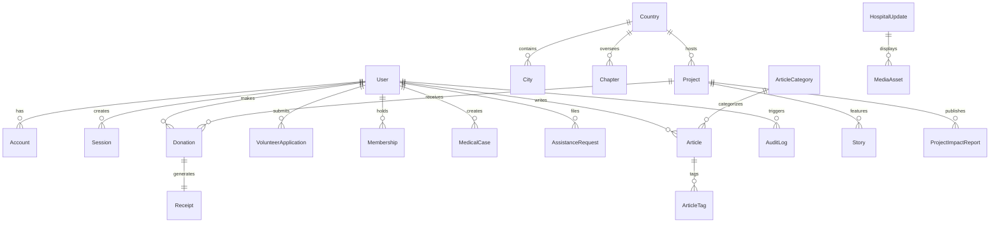

# Database Schema Specification & Data Architecture

This document provides a comprehensive structural guide to the database schema defined in `prisma/schema.prisma` for the **Zulaid Chaudhary Foundation** (`ZulaidChaudharyFoundation.com`).

---

## 1. Schema Design Philosophy

The database model is built around six inviolable principles:
1. **Zero Cardholder Data:** No card numbers, CVVs, or bank account credentials are ever stored. Payments rely on tokenized provider references (`providerReference`).
2. **Clinical Confidentiality & Privacy Vaults:** Sensitive medical records (`MedicalCase`) and whistleblowing complaints (`Complaint`) are segregated with strict access gates, field-level encryption at rest, and audit logging for every read or modification.
3. **Informed Consent Gatekeeping:** Patient stories (`Story`) cannot be published without a foreign key verification to a signed physical or digital consent record (`consentFormRef` + `isConsentVerified = true`).
4. **Verified Milestone Integrity:** All public statistics (`ImpactMetric`), project progress figures, and financial summaries have mandatory `isVerified` flags tied to the admin user who verified them (`verifiedByUserId`). Unverified data is prevented from surfacing on public landing pages.
5. **Configurable Regulatory & Legal Status:** A dedicated `SystemSetting` key (`LEGAL_STATUS`) governs all public legal disclaimers. Until officially set to `REGISTERED`, the UI defaults to neutral phrasing ("Registration in progress").
6. **Multi-Country, Multi-Currency & Bilingual First:** All content entities store symmetrical English (`...En`) and Urdu (`...Ur`) columns; financial models support multi-currency allocations (`PKR`, `USD`, `GBP`, `EUR`, `CAD`, `AED`).

---

## 2. Entity-Relationship Model

---

## 3. Core Domain Models & Specifications

### 3.1. Identity, Roles & Scopes (`User`, `Account`, `Session`)
- **Roles:**
  - `SUPER_ADMIN`: Founder (Zulaid Chaudhary) with global privileges.
  - `ADMIN`: General platform administration and oversight.
  - `CONTENT_EDITOR`: CMS articles, blog, project updates, media management.
  - `MEDICAL_COORDINATOR`: Patient case intake, clinical vetting, doctor communications.
  - `FINANCE_OFFICER`: Donation auditing, offline wire slip verification, financial statement publishing.
  - `VOLUNTEER_COORDINATOR`: Volunteer application vetting, chapter assignments.
  - `COUNTRY_COORDINATOR`: Regionally scoped management via `countryScopeId`.
  - `DONOR_USER`, `VOLUNTEER_USER`, `MEMBER_USER`: Base authenticated roles for public users.
- **Two-Factor Authentication:** TOTP secrets stored with application-level encryption for administrative roles.

### 3.2. Geographic Chapters & International Scope (`Country`, `City`, `Chapter`)
- Enables local and international chapter operations (Lahore HQ, Karachi, Islamabad, US Diaspora Chapter, UK Chapter).
- Each chapter maintains local contact points, volunteer coordinators, and designated banking conduits.

### 3.3. Projects, Campaigns & Impact Reports (`Project`, `Campaign`, `ProjectImpactReport`)
- Categorized across 9 humanitarian pillars: Healthcare Assistance, Hospital Construction, Food/Ration, Medicine Aid, Education, Human Rights, Environment & Water, Animal Welfare, Disaster Relief.
- Financial tracking: `targetBudget`, `raisedAmount`, `currency`.
- Direct tie-in to verified milestone reports (`ProjectImpactReport`) containing structured JSON metrics and signed PDF documents.

### 3.4. Donations, Receipts & Financial Ledger (`Donation`, `Receipt`, `FinancialReport`)
- **Ledger Records:** Every gift generates a deterministic receipt code (`ZCF-REC-YYYY-XXXXX`).
- **Offline Pakistani Support:** Supports manual bank wire slips (`bankProofImageUrl`) verified manually by a Finance Officer before the receipt is issued.
- **Deductibility Safeguard:** `taxExemptDeductible` remains `false` until legal registration is confirmed, displaying transparent disclaimers on all receipts.

### 3.5. Clinical Assistance & Medical Cases (`MedicalCase`, `AssistanceRequest`)
- Strictly access-gated to Super Admin and Medical Coordinators.
- Mandatory consent tracking: `hasInformedConsent`, `consentSignedDate`, `consentDocumentUrl`.
- Direct links to recommended hospitals (e.g. Lahore partner hospitals) and treating physicians.

### 3.6. Hospital Construction Tracker (`HospitalUpdate`, `HospitalDepartment`)
- Powers the interactive hospital timeline component on the public site.
- Tracks phase-by-phase completion (Phase 1 Groundwork, Phase 2 Grey Structure, Phase 3 Fitout), verified engineering blueprints, and future medical department capacities.

### 3.7. Content, Advocacy & Beneficiary Stories (`Article`, `Story`, `MediaAsset`)
- Symmetrical bilingual content columns (`titleEn`/`titleUr`, `contentEn`/`contentUr`).
- `Story` model enforces a mandatory foreign key link to an archived consent record before publication.

### 3.8. Immutable Audit Trail (`AuditLog`)
- Automatically records the acting user, IP address, user agent, action verb (`CREATE`, `UPDATE`, `DELETE`, `APPROVE`, `REJECT`), and JSON diffs of `oldData` vs `newData`.

---

## 4. Indexing & Query Optimization Strategy

1. **Authentication:** B-Tree unique indexes on `User.email`, `Session.sessionToken`, and compound index on `Account [provider, providerAccountId]`.
2. **Public Content Lookups:** Unique indexes on `Project.slug`, `Campaign.slug`, `Article.slug`, `Story.slug` for rapid sub-millisecond edge lookups.
3. **Audit & Queue Filtering:** Compound indexes on `AuditLog [entity, entityId]`, `AuditLog.timestamp`, `Donation.paymentStatus`, `MedicalCase.status`, and `VolunteerApplication.status`.
4. **Search:** Text fields configured for future PostgreSQL full-text search (`tsvector`) across article titles and research summaries.
